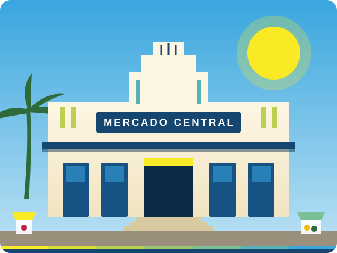

# O Mercado Novo

No final da década de 1930, São Luís passou por um amplo programa de modernização urbana. Inspiradas nas ideias sanitaristas da época, as autoridades buscavam abrir avenidas, melhorar a circulação e substituir construções consideradas inadequadas aos novos padrões de higiene.

Em 1939, o antigo mercado foi demolido. No mesmo período, foi aberta em diagonal a Avenida Magalhães de Almeida, ligando o tráfego da cidade diretamente ao local onde seria erguido o novo prédio.

## Inauguração em 12 de maio de 1941

O novo edifício foi entregue à população em 12 de maio de 1941. Por muitos anos, foi chamado simplesmente de Mercado Novo. Sua arquitetura seguia o estilo Art Déco, muito presente nos prédios públicos brasileiros daquele período.

## Como reconhecer o Art Déco

Quem observa a fachada com atenção percebe alguns elementos característicos:

- **Simetria:** os dois lados do prédio se espelham a partir do centro.
- **Linhas verticais na platibanda:** faixas que dão a sensação de altura e elegância.
- **Marquise de concreto armado:** protege do sol e da chuva quem chega para comprar.
- **Escadaria central:** acompanha o desnível do terreno na fachada principal.

Mesmo com tantas mudanças no Centro ao longo das décadas, o prédio permaneceu como uma referência da paisagem da cidade.
