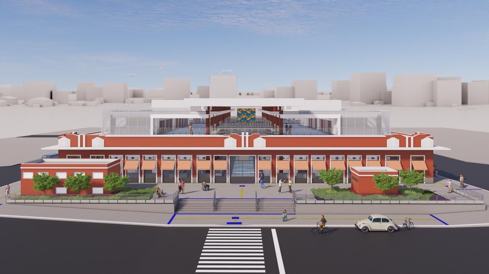

# Patrimônio e futuro

O Mercado Central está no coração do Centro Histórico de São Luís, cujo conjunto urbano é protegido pelo IPHAN desde 1974 e pelo Governo do Maranhão desde 6 de março de 1986 (Decreto Estadual nº 10.089). Em 1997, o Centro Histórico foi reconhecido pela UNESCO como Patrimônio Mundial, por seu valioso acervo de arquitetura colonial portuguesa e seus casarões de azulejos.

## Um novo começo

Em 20 de abril de 2016, um incêndio num box de artesanato mostrou a precariedade das instalações. Depois de anos de impasse, a Justiça condenou o Município, em 18 de agosto de 2023, a restaurar o Mercado.

Em 12 de novembro de 2025, a Prefeitura entregou o Mercado da Cidade, no Aterro do Bacanga, com quatro galpões e espaço para cerca de 450 comerciantes. A mudança dos feirantes aconteceu entre fevereiro e março de 2026.

Em 4 de julho de 2026, foi assinada a ordem de serviço da obra: R$ 44,9 milhões, um prédio de três andares e espaço para 285 feirantes. O projeto divulgado previa preservar as fachadas antigas. Mas a estrutura estava em risco de desabamento: depois de uma audiência na Justiça em 2 de setembro, o prédio foi demolido em 10 de setembro de 2026. No mesmo lugar será construído o novo Mercado Central.

## Um ponto de partida

Por estar em uma posição central, o Mercado é um excelente ponto de partida para conhecer a ilha. A pé, é possível chegar à Praia Grande, à Rua Portugal, à Casa das Tulhas, ao Palácio dos Leões e às igrejas históricas. Um pouco mais longe, estão as praias, a Lagoa da Jansen, o Espigão Costeiro e os municípios vizinhos de São José de Ribamar e Raposa.

O **mapa interativo** deste portal foi pensado exatamente assim: o Mercado Central no centro e, a partir dele, caminhos para os principais pontos turísticos da Ilha de São Luís.

## Para todas as pessoas

Preservar o Mercado também significa garantir que todas as pessoas possam conhecê-lo, visitá-lo e contar a sua história. Acessibilidade não é um detalhe: é parte do direito à cidade.

Que este livro seja um convite para que você visite, escute e participe.
